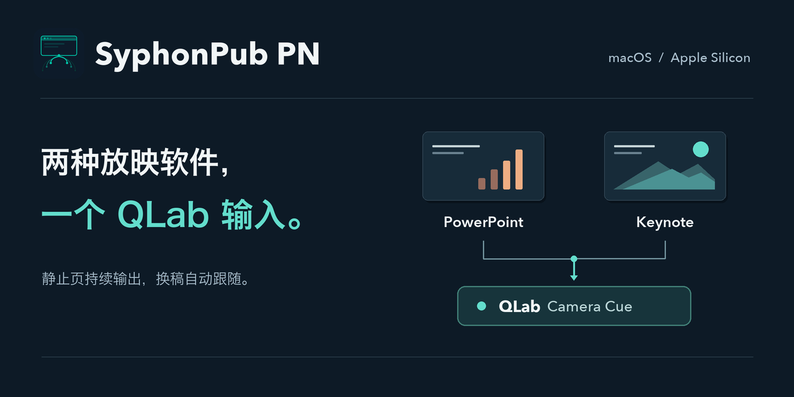

# SyphonPub PN · PowerPoint and Keynote to QLab over Syphon

Run PowerPoint, Keynote and QLab on one Mac. SyphonPub PN follows the audience slide as speakers change decks and publishes it to a single **QLab Camera Cue**. A speaker can leave the title slide on screen while the operator runs a transition. When the operator presses GO, the cue can receive that slide even if nothing on it has moved.

[Download v1.4.4 for Apple Silicon](https://github.com/Unreal2Real/SyphonPub-PN/releases/download/v1.4.4/SyphonPub-PN-1.4.4-macOS-arm64.zip) · [Latest release and SHA-256 checksum](https://github.com/Unreal2Real/SyphonPub-PN/releases/latest) · [WeChat contact](#contact-the-maintainer) · [中文使用说明](README.md)



## Connect your first slide

1. On an **Apple Silicon Mac running macOS 14.6 or later**, unzip the release and move **SyphonPub PN.app** to Applications. The distribution uses an ad hoc signature and has no Apple notarization.
2. Open the presentation app you plan to use and leave it in edit mode. In SyphonPub PN, open **放映软件授权…** (presentation app permissions) and allow it to read the slideshow state. Select **自动跟随放映** (follow slideshow), leave the rate at **30 FPS**, and click **Start**. Grant SyphonPub PN Screen Recording access in macOS Privacy & Security when prompted. Relaunch and click Start again if macOS requests it.
3. In QLab, select a **Camera Cue**. Under **I/O → Video Input → New patch with camera device**, choose publisher **SyphonPub PN** and source `SyphonPub Show Follow — Audience`. Open **Monitor** beside Video Input. If you already have an input patch for this source, select it there.
4. Start the PowerPoint slideshow, or choose **Play → In Window** in Keynote and start playback. Keep the Keynote audience window open and expanded. Verify the first slide in QLab’s input monitor before taking it to the audience.

Syphon carries the slide video on the same Mac. Route any sound from embedded media separately and check it during rehearsal. QLab also lets you choose an audio input for a Camera Cue. [QLab Camera Cue documentation](https://qlab.app/docs/v5/video/camera-cues/)

## Switch decks during a show

Run a transition in QLab, end the outgoing slideshow, then start the next one. Both presentation apps can stay open. Play one deck at a time. The Syphon source sends black between shows and resumes with the first valid frame from the incoming deck. Confirm the new title slide in the same input monitor, then press GO. The input patch and Camera Cue carry over between speakers.

| Operator question | What to do |
| --- | --- |
| Can I start the cue after the title slide has been still for 30 seconds? | Yes. Leave the slideshow and auto-follow running. The app holds the latest valid frame on the GPU and republishes it at 15, 24, 30 or 60 FPS. Open the input monitor while the slide is still to check what a late receiver sees. |
| Keynote is already playing. Why is SyphonPub PN still waiting? | Show the presenter display once in the active Keynote deck to help identify its audience window. For the next deck, start auto-follow before starting windowed playback. |
| Keynote goes black when I switch to QLab. Which playback mode should I use? | End full-screen playback and use **Play → In Window**. Keep the audience window expanded while you operate QLab. |
| How do I overlay a live camera on the slides? | Route the slide cue and camera cue to the same QLab stage. Put the camera on a higher layer. Check the slide in the input monitor and the composite in the stage monitor. |
| Can I capture a browser window or an entire display? | During a transition, click **Stop**, choose **手动选择** (manual selection), click **Refresh**, select the source and click **Start**. Manual capture publishes under its own source name. Check the corresponding QLab input. |

## Rehearse and verify

The PowerPoint and Keynote follow workflows were accepted by the show operator. Development checks used Apple M1, macOS 27.0.1, QLab 5.6.3, PowerPoint 16.114.4 and Keynote 15.4.

In a windowed Keynote test during 1.4.3 development, slide 2 stayed still with another app in the foreground. At a target of 30 FPS, an independent Syphon receiver recorded 245 frame notifications. All 39 pixel samples matched the four marks on the expected 3840 × 2160 slide. [Receiver log](Tests/Integration/Results/keynote-windowed-1.4.3.txt)

For your own rehearsal, give consecutive decks visibly different first slides. Try **PowerPoint → Keynote → PowerPoint**, wait on one slide for 30 seconds before pressing GO, then check an embedded video and the camera overlay on the audience screen. [PowerPoint test deck](Tests/Fixtures/SyphonPub-QA.pptx) · [Test deck to open in Keynote](Tests/Fixtures/SyphonPub-Keynote-Audience-QA.pptx)

## Build from source

The app uses Swift, ScreenCaptureKit, Metal and Syphon. With Apple Command Line Tools installed on an Apple Silicon Mac, run the following from the repository root. The ZIP is written to `build/`.

```sh
./scripts/build-local.zsh
```

The repository includes tests for audience-window selection, late receivers and deck changes. The GPU tests publish and receive known images in separate processes. [Test commands](Tests/README.md)

## Contact the maintainer

Scan the QR code in WeChat to reach **L** about using SyphonPub PN at a show. Include “SyphonPub PN” in the friend request.

<a href="docs/media/wechat-contact.jpg"></a>

For a reproducible issue, include your macOS, QLab and presentation app versions, the playback mode, and what appeared in QLab’s **Video Input → Monitor**. [GitHub Issues](https://github.com/Unreal2Real/SyphonPub-PN/issues)

## Credits and license

SyphonPub PN builds on Xylopyrographer’s SyphonPub 1.2. It retains the upstream MIT license and copyright notice. The bundled Syphon Framework has its own redistribution terms. [Upstream SyphonPub](https://github.com/Xylopyrographer/SyphonPub) · [Project license](LICENSE) · [Syphon Framework notice](Licenses/Syphon-Framework.txt)
