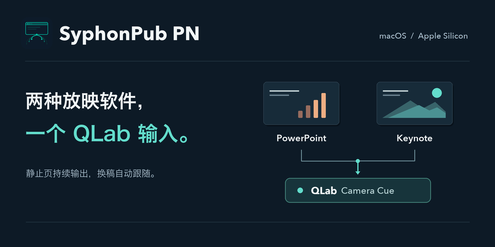

# SyphonPub PN

**把 PowerPoint 和 Keynote 的观众画面送进同一个 QLab Camera Cue。** 讲者换稿，操作员可以留在 QLab 里看输入监看、播过渡、叠加实体摄像机。幻灯片停在首页时，SyphonPub PN 也会持续发送当前页，稍后按 GO 的 Cue 可以直接接收。

SyphonPub PN is a macOS app for live shows. It follows the audience slide from PowerPoint or windowed Keynote and publishes it to a single Syphon input for QLab, including while the slide is still.

[](docs/media/syphonpub-pn.png)

[下载 macOS Apple Silicon 版](https://github.com/Unreal2Real/SyphonPub-PN/releases/download/v1.4.4/SyphonPub-PN-1.4.4-macOS-arm64.zip) · [所有版本](https://github.com/Unreal2Real/SyphonPub-PN/releases) · [1.4.4 更新与迁移](docs/RELEASE-1.4.4.md)

## 第一次接入 QLab

1. 在 Apple Silicon Mac 上解压发布包，将 **SyphonPub PN.app** 拖入「应用程序」。最低系统版本为 macOS 14.6。
2. 打开本场要用的放映软件，先留在编辑界面。在 SyphonPub PN 的「放映软件授权…」中，允许读取对应软件的放映状态。选择「自动跟随放映」，保留默认 **30 FPS**，点 **Start**。macOS 若请求录屏权限，请在「系统设置 → 隐私与安全性」中为 SyphonPub PN 开启录屏。若系统提示重新打开，重开后再点 Start。
3. 在 QLab 的 **Workspace Settings → Video → Video Inputs** 添加一个输入，选择发布程序 **SyphonPub PN** 的 **SyphonPub Show Follow — Audience**。把「PPT」Camera Cue 的 **Video Input** 设为该输入，点 **Monitor**。可把摄像机设在更高图层，和幻灯片一起输出。
4. PowerPoint 照常开始放映。Keynote 选「播放 → 在窗口中」，再开始播放。让只显示当前页的观众窗口保持展开。先在 QLab 输入监看核对首页，再切到观众屏。

发行包采用本地签名（ad hoc），尚未使用 Apple Developer ID 签名并公证。也可以按下方说明从源码构建。若现场 Mac 由组织管理，请按管理员的安装策略操作。

## 演出中换稿

在 QLab 播放过渡 → 结束上一份放映 → 开始新稿 → 在同一个输入监看认出新首页 → GO。

一次只播放一份稿。PowerPoint 和 Keynote 可以同时打开，也可以交替上场。SyphonPub PN 会在两场之间输出黑场，取得新稿的第一张有效画面后恢复输出。整个换稿过程沿用原来的输入和 Cue，SyphonPub PN 全场只需 Start 一次。

| 现场情况 | 处理方式 |
| --- | --- |
| 幻灯片静止，稍后才启动 Cue | 保持自动跟随运行。应用在 GPU 上保留最新有效画面，按所选帧率持续发布。可选 15、24、30 或 60 FPS。 |
| Keynote 已经播放，自动跟随仍在等待 | 在正在放映的 Keynote 中显示一次「演讲者显示器」，帮助核实同一文稿的观众窗口。稳定的开场顺序是先启动跟随，再开始窗口放映。 |
| 切到 QLab 后，Keynote 全屏放映变黑 | 结束这次放映，改用「播放 → 在窗口中」。窗口放映让操作员能在同一台 Mac 上留在 QLab。 |
| 临时需要捕捉浏览器窗口或整块显示器 | 在过渡期间点 Stop，切到「手动选择」，Refresh 后选中所需来源并 Start。手动模式会显示自己的来源名，请在 QLab 核对输入。 |

## 验证范围

现场使用者已完成 PowerPoint 和 Keynote 跟随流程的验收。开发验证使用 Apple M1、macOS 27.0.1、QLab 5.6.3、PowerPoint 16.114.4 和 Keynote 15.4。一次独立的 Keynote 窗口测试以 30 FPS 发送 3840 × 2160 的静止页，Syphon 接收端的 39 次像素抽样均匹配预期页面。当时 Keynote 已经在后台，采样内容是窗口放映的第二页。

彩排时用两份首页明显不同的稿件，检查「PowerPoint → Keynote → PowerPoint」、静止 30 秒后 GO、内嵌视频，以及实体摄像机叠加后的观众屏。每次换稿都能在同一个输入监看认出新页，再把这个配置用于正式演出。

独立彩排可以使用仓库里的两份文稿，先核对幻灯片内容，再确认舞台合成。[PowerPoint 测试稿](Tests/Fixtures/SyphonPub-QA.pptx) · [可用 Keynote 打开的测试稿](Tests/Fixtures/SyphonPub-Keynote-Audience-QA.pptx)

## 从源码构建

项目使用 Swift、ScreenCaptureKit、Metal 和 Syphon。在已安装 Apple Command Line Tools 的 Apple Silicon Mac 上，从本仓库根目录运行打包脚本。输出 ZIP 位于 `build/`。

```sh
./scripts/build-local.zsh
```

源码包含只读的放映识别测试，以及用两个独立进程验证静止页与换稿的 GPU 收发测试。[运行项目测试](Tests/README.md)

## 上游与许可

SyphonPub PN 基于 Xylopyrographer 的 SyphonPub 1.2 开发。项目保留上游 MIT 许可证与版权声明。Syphon Framework 和 Metal 接口的版权及再分发条款随源码和应用分发。[上游 SyphonPub](https://github.com/Xylopyrographer/SyphonPub) · [项目许可证](LICENSE) · [Syphon Framework 声明](Licenses/Syphon-Framework.txt)
